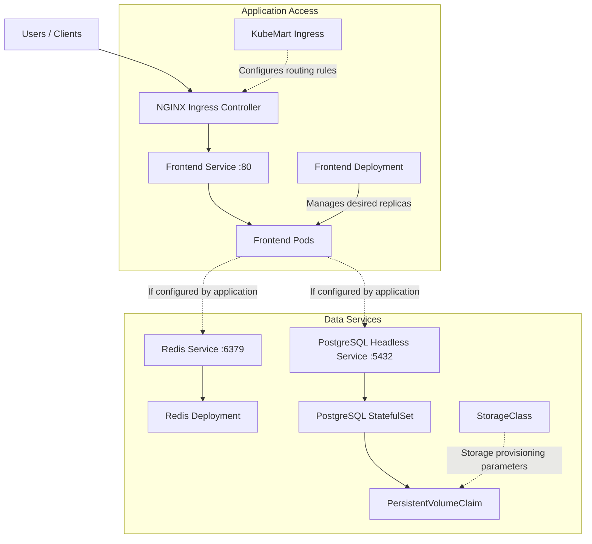
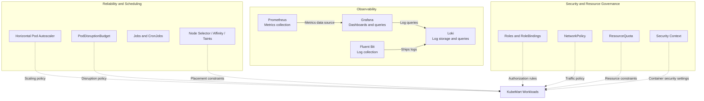

# ☸️ KubeMart — Kubernetes E-Commerce Platform

<p align="center">
  <strong>A hands-on Kubernetes platform focused on cloud-native deployment, reliability, security, and observability.</strong>
</p>

<p align="center">
  
  
  
  
  
  
</p>

---

## 📖 Overview

**KubeMart** is a Kubernetes learning and engineering project built to explore how cloud-native workloads are deployed, exposed, secured, scheduled, monitored, and maintained.

The repository brings together Kubernetes manifests, Helm configuration, operational scripts, and technical documentation. Its focus is on understanding Kubernetes concepts through practical implementation rather than relying only on theoretical examples.

### Project goals

- Deploy and manage application workloads using Kubernetes.
- Expose applications through Services and Ingress.
- Configure application settings and sensitive configuration separately.
- Explore persistent storage for stateful workloads.
- Practice health, availability, scheduling, and autoscaling concepts.
- Apply Kubernetes security controls and access management.
- Build an observability stack for metrics, dashboards, and logs.
- Document implementation decisions, verification steps, and troubleshooting.

> **Project status:** This repository contains implementation manifests and learning labs. The presence of a manifest does not, by itself, prove that the resource is currently deployed or production-ready.

---

## 🏗️ Architecture

The following is a **logical architecture overview** based on the components represented in this repository. It describes intended component relationships, not a live inventory of deployed resources.

### 1. Application Architecture

This diagram shows the intended application request path and data-service relationships. Application-to-database connections must be verified against the application configuration.



### 2. Platform Operations

This diagram separates operational controls from application traffic. Dashed lines represent configuration or policy relationships, not direct network traffic.



### Architecture notes

- **Ingress and Services:** provide the configuration path for routing external application traffic to Kubernetes workloads.
- **Frontend:** the repository includes a frontend Deployment and Service.
- **PostgreSQL:** represented by a StatefulSet, Service, and persistent-storage configuration.
- **Redis:** represented by a Deployment and Service.
- **Reliability:** includes HPA and PodDisruptionBudget manifests, along with workload scheduling examples.
- **Security:** includes RBAC, NetworkPolicy, ResourceQuota, and security-context examples.
- **Observability:** includes configuration for Prometheus, Grafana, Loki, and Fluent Bit.

Dashed connections indicate policies, configuration relationships, or application dependencies that must be verified against the deployed configuration. They do not establish that every connection is currently active.

### Edit the architecture diagram

The diagram above is written in Mermaid. To change it:

1. Open `README.md`.
2. Find the section starting with ` ```mermaid `.
3. Edit the nodes and connections inside that block.
4. Save and push the changes to GitHub.
5. Open the repository README to see the rendered diagram.

You can also copy the Mermaid block into the [Mermaid Live Editor](https://mermaid.live/) to preview changes before committing them.

---

## 🧰 Technology Stack

| Technology | Purpose |
|---|---|
| Kubernetes | Workload orchestration and cluster resource management |
| containerd | Container runtime |
| Flannel | Cluster pod networking |
| Kubernetes Services | Stable internal service discovery and access |
| Ingress | HTTP/HTTPS routing configuration |
| PostgreSQL | Relational database workload |
| Redis | In-memory data-store workload |
| PersistentVolumeClaim / StorageClass | Persistent-storage configuration |
| Helm | Packaging and configuration of supported components |
| Prometheus | Metrics collection and monitoring |
| Grafana | Dashboards and visualization |
| Loki | Log aggregation |
| Fluent Bit | Log collection and forwarding |

The exact deployed versions and enabled features should be verified against the running cluster and Helm releases.

---

## 📂 Repository Structure

```text
KubeMart/
├── docs/
│   ├── phase-05-external-access.md
│   ├── phase-06-reliability.md
│   └── phase-07-workloads.md
├── helm/
├── k8s/
│   ├── autoscaling/
│   ├── config/
│   ├── deployments/
│   ├── examples/
│   ├── helm/
│   ├── ingress/
│   ├── jobs/
│   ├── monitoring/
│   ├── namespace/
│   ├── policies/
│   ├── scheduling/
│   ├── security/
│   ├── services/
│   ├── statefulsets/
│   ├── storage/
│   └── workloads/
├── manifests/
├── scripts/
├── .gitignore
└── README.md
```

Directory contents may evolve as the project progresses.

---

## ☸️ Kubernetes Topics Covered

### Workloads and application access

- Deployments and Pods
- Services and service discovery
- Ingress routing
- StatefulSets
- Jobs and CronJobs
- Init containers and sidecar examples

### Reliability and scaling

- Horizontal Pod Autoscaler configuration
- PodDisruptionBudget
- Workload health and availability concepts
- Resource management and scheduling constraints

### Scheduling

- Node selectors
- Affinity and anti-affinity concepts
- Taints and tolerations

### Security

- ServiceAccounts and RBAC-related resources
- Role and RoleBinding examples
- NetworkPolicy examples
- Security contexts
- ResourceQuota
- Separation of sensitive configuration from application manifests

### Storage

- StorageClass configuration
- PersistentVolumeClaim
- Stateful workload storage
- PostgreSQL storage verification examples

### Observability

- Prometheus configuration
- Grafana configuration
- Loki configuration
- Fluent Bit configuration

---

## 🚀 Getting Started

### Prerequisites

A working Kubernetes environment is required for cluster operations.

Recommended tools:

- `kubectl`
- Helm
- Git
- Access to a Kubernetes cluster and the required permissions

The exact cluster setup depends on your environment.

### 1. Clone the repository

```bash
git clone https://github.com/mhmdhmdbdh2050/kubemart-kubernetes-platform.git
cd kubemart-kubernetes-platform
```

If you already have the project locally, navigate to its directory instead.

### 2. Inspect the cluster

```bash
kubectl cluster-info
kubectl get nodes -o wide
kubectl get namespaces
```

Confirm that the cluster is reachable and the nodes are in a healthy state before applying workloads.

### 3. Review the manifests

```bash
find k8s manifests helm scripts docs -maxdepth 3 -type f | sort
```

Inspect the namespace, application configuration, Services, storage, Ingress, and monitoring manifests before deployment.

### 4. Review configuration and secrets

```bash
cat k8s/config/frontend-config.yaml
cat k8s/config/frontend-secret.example.yaml
```

Use the example secret file as a template where appropriate. Create real secret configuration locally and verify the repository's ignore rules before committing changes.

**Never paste real passwords, tokens, or private credentials into this README or a public Git repository.**

### 5. Verify deployed resources

The following commands are for inspection; they do not create or modify resources.

```bash
kubectl get all -A
kubectl get ingress -A
kubectl get pvc -A
kubectl get hpa -A
kubectl get pods -A
```

Use the results to establish which resources are actually deployed. Apply manifests only after reviewing their dependencies, namespace settings, storage requirements, and configuration.

> **Important:** There is no universal one-command deployment procedure documented here. Apply the resources in the order required by their dependencies and the current cluster configuration.

---

## 📊 Monitoring and Logging

The repository contains configuration files for:

- **Prometheus:** metrics collection and monitoring configuration.
- **Grafana:** dashboard and data-source configuration.
- **Loki:** log aggregation configuration.
- **Fluent Bit:** log collection and forwarding configuration.

Useful inspection commands:

```bash
helm list -A
kubectl get pods -A
kubectl get services -A
kubectl get configmaps -A
```

A configuration file existing in the repository does not guarantee that its Helm release is installed, its Pods are healthy, or its dashboards and data sources are working. Verify each component independently.

---

## 🔐 Security Considerations

- Never commit real credentials or unredacted Secret manifests.
- Use example files for documentation and safe configuration templates.
- Review `.gitignore` before staging configuration files.
- Apply least-privilege RBAC permissions.
- Restrict network traffic where suitable NetworkPolicies are supported.
- Use appropriate container security contexts.
- Define resource requests and limits according to workload requirements.
- Review Kubernetes and Helm changes before applying them to a cluster.
- Rotate any credential that may have been exposed.

Kubernetes Secrets provide an API mechanism for handling sensitive values; they should not automatically be treated as encrypted or safe merely because they are stored in a Secret object. Configure appropriate access controls and encryption at rest for the cluster.

---

## 🧪 Troubleshooting

Start with cluster and workload status:

```bash
kubectl get nodes -o wide
kubectl get pods -A
kubectl get events -A --sort-by=.metadata.creationTimestamp
```

Inspect a particular Pod:

```bash
kubectl describe pod <pod-name> -n <namespace>
kubectl logs <pod-name> -n <namespace>
```

Inspect application routing and storage:

```bash
kubectl get ingress,services -A
kubectl get pvc -A
kubectl get endpointslices -A
```

Replace placeholders such as `<pod-name>` and `<namespace>` with the actual values from your cluster.

For a production incident, correlate Pod events, application logs, Service selectors, EndpointSlices, readiness probes, network policies, and resource constraints before changing the configuration.

---

## 🗺️ Roadmap

The project can continue to evolve through the following areas:

- Complete and validate the observability dashboards.
- Improve security policies and least-privilege access.
- Verify autoscaling behavior under representative load.
- Expand automated validation and operational scripts.
- Improve deployment reproducibility and configuration management.
- Document recovery procedures and operational runbooks.
- Add repeatable testing for application availability and dependencies.

These are development goals, not claims that every item is already implemented.

---

## 📚 Documentation

Implementation notes are maintained in the `docs/` directory. Start with the phase documents to understand the project's external-access, reliability, and workload exercises.

For practical learning, follow this cycle:

**Understand → Implement → Verify → Troubleshoot → Document**

---

## 👨‍💻 Author

**Mohamed Ahmed Abdo**

DevOps and Cloud Engineering | Kubernetes | Linux | Docker | AWS

GitHub: [@mhmdhmdbdh2050](https://github.com/mhmdhmdbdh2050)

Project repository: [KubeMart Kubernetes Platform](https://github.com/mhmdhmdbdh2050/kubemart-kubernetes-platform)

---

## 📄 License

No license is declared in this README. Add an appropriate `LICENSE` file if you intend to grant others permission to use, modify, or distribute this project.

---

<p align="center">
  <em>Built to learn Kubernetes through hands-on engineering and continuous improvement.</em>
</p>
