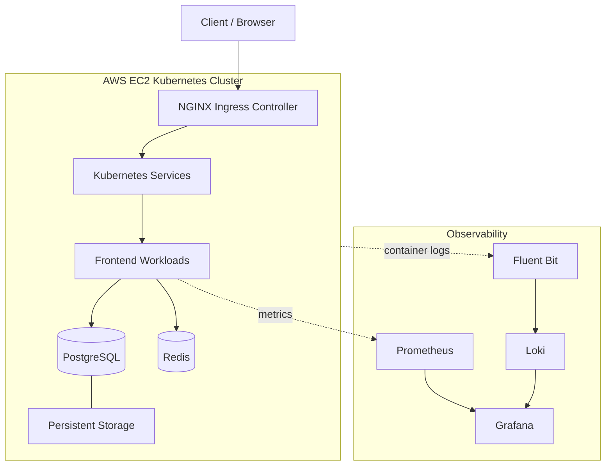

# ☸️ KubeMart — Cloud-Native Kubernetes E-Commerce Platform

<p align="center">
  <strong>Build. Deploy. Secure. Observe. Learn.</strong>
</p>

<p align="center">
  A hands-on Kubernetes engineering project exploring application deployment, persistent storage, traffic routing, workload reliability, security, and observability on AWS.
</p>

<p align="center">
  
  
  
  
  
  
  
</p>

---

## 📌 Overview

**KubeMart** is a practical Kubernetes learning and engineering project built on an AWS EC2-based cluster. It brings together application workloads, networking, stateful services, persistent storage, workload scheduling, security controls, and observability.

The project emphasizes understanding how Kubernetes components interact, how to verify deployments, and how to investigate operational failures—not simply applying YAML manifests.

> **Project status:** Ongoing. Core platform components and several workload, scheduling, monitoring, and logging exercises have been implemented. Final documentation, security review, and publication tasks are still in progress.

## 🏗️ Architecture



*Conceptual overview of the platform. Exact traffic paths, metrics endpoints, and workload configurations depend on the individual manifests and deployed components.*

## 🧰 Technology Stack

| Area | Technologies |
|---|---|
| Cloud infrastructure | AWS EC2 |
| Operating system | Ubuntu Server |
| Container orchestration | Kubernetes |
| Container runtime | containerd |
| Cluster networking | Flannel CNI |
| Traffic routing | NGINX Ingress Controller |
| Application services | Frontend, PostgreSQL, Redis |
| Persistent storage | Kubernetes PVCs and StorageClass |
| Package management | Helm |
| Metrics and dashboards | Prometheus, Grafana |
| Centralized logging | Loki, Fluent Bit |
| Automation and configuration | YAML manifests, Helm values |
| Version control | Git and GitHub |

## ✨ What This Project Covers

### 🚀 Application Deployment and Networking
- Kubernetes Deployments and Services.
- Ingress-based application routing.
- Multi-component application architecture.
- Helm chart structure, templates, and configurable values.

### 💾 Stateful Workloads and Storage
- PostgreSQL StatefulSet and persistent-volume claims.
- StorageClass configuration.
- Redis deployment.
- Practical exploration of stateful workloads and storage behavior.

### 🛡️ Reliability and Workload Management
- Horizontal Pod Autoscaler concepts and configuration.
- Jobs and CronJobs.
- Pod disruption budgets.
- Resource requests, limits, and scheduling constraints.
- Node selectors, affinity, taints, and tolerations.

### 🔐 Kubernetes Security
- Role-Based Access Control (RBAC).
- Service accounts and permission boundaries.
- Security contexts.
- NetworkPolicy examples.
- ResourceQuota configuration.
- Secret-handling practices and Git exclusion rules.

### 📊 Observability
- Prometheus metrics collection.
- Grafana dashboards and data sources.
- Loki log aggregation.
- Fluent Bit log collection and forwarding.
- Practical log exploration and troubleshooting.

## 📁 Repository Structure

```text
KubeMart/
├── docs/                   # Phase documentation and implementation notes
├── k8s/
│   ├── autoscaling/        # HPA resources
│   ├── config/             # Application configuration and secret templates
│   ├── deployments/        # Application deployments
│   ├── examples/           # Pod patterns and learning examples
│   ├── helm/               # Helm chart and values files
│   ├── ingress/            # Ingress resources
│   ├── jobs/               # Jobs and CronJobs
│   ├── monitoring/         # Prometheus, Grafana, Loki, Fluent Bit values
│   ├── namespace/          # Namespace definitions
│   ├── policies/           # Reliability policies
│   ├── scheduling/         # Scheduling examples
│   ├── security/           # RBAC and security manifests
│   ├── services/           # Kubernetes Services
│   ├── statefulsets/       # Stateful application workloads
│   ├── storage/            # StorageClass and PVC resources
│   └── workloads/          # Additional workload examples
└── README.md
```

## ⚙️ Environment

The documented cluster environment includes:

- One Kubernetes control-plane node.
- Two Kubernetes worker nodes.
- AWS EC2 instances running Ubuntu.
- Kubernetes v1.37.1.
- Flannel as the cluster CNI.
- containerd as the container runtime.

Cluster availability, resource capacity, cloud costs, and installed component versions can change over time.

## 🚦 Getting Started

### Prerequisites

- Access to a Kubernetes cluster.
- `kubectl` configured to communicate with the intended cluster.
- Helm installed if you intend to use the Helm chart or monitoring releases.
- Suitable storage provisioning for persistent-volume claims.
- The container images and configuration required by the selected workload.

### 1. Clone the repository

```bash
git clone https://github.com/mhmdhmdbdh2050/kubemart-kubernetes-platform.git
cd kubemart-kubernetes-platform
```

### 2. Verify cluster access

```bash
kubectl cluster-info
kubectl get nodes -o wide
kubectl get namespaces
```

### 3. Inspect the manifests

```bash
find k8s -type f \
  \( -name '*.yaml' -o -name '*.yml' \) \
  | sort
```

Review the relevant manifest and its dependencies before applying it.

### 4. Validate a manifest

```bash
kubectl apply --dry-run=server -f path/to/manifest.yaml
```

Replace the example path with the actual manifest you intend to validate. Server-side dry-run requires a reachable cluster and sufficient permissions.

### 5. Apply resources deliberately

```bash
kubectl apply -f path/to/manifest.yaml
kubectl get pods -A
kubectl get services -A
```

These are examples, not a complete one-command installation procedure. Apply resources in dependency order and review each manifest before deploying it.

## 🔒 Security Notes

- Real credentials must never be committed to Git.
- Use the provided example secret templates as templates only.
- Kubernetes Secret values encoded in Base64 are not automatically encrypted.
- Do not expose kubeconfig files, private keys, access tokens, or cloud credentials.
- Apply RBAC with the minimum permissions required.
- Review NetworkPolicy behavior against the actual CNI and cluster configuration.
- Inspect resource permissions and security contexts before deploying workloads.

## 🧪 Verification and Troubleshooting

Useful inspection commands:

```bash
kubectl get nodes
kubectl get pods -A
kubectl get events -A --sort-by=.lastTimestamp
kubectl get services -A
kubectl get ingress -A
kubectl get pvc -A
```

For a specific workload:

```bash
kubectl describe pod <pod-name> -n <namespace>
kubectl logs <pod-name> -n <namespace>
```

Replace placeholders with actual resource names and namespaces. These commands are intended for inspection and troubleshooting; they do not repair every possible failure automatically.

## 🗺️ Project Roadmap

The learning roadmap is organized around these areas:

1. Architecture and environment.
2. Application workloads.
3. Configuration management.
4. Stateful services and storage.
5. External access and traffic routing.
6. Reliability and scaling.
7. Jobs and background workloads.
8. Scheduling and placement.
9. Security and access control.
10. Monitoring, logging, and troubleshooting.
11. Repository publication.
12. Final review and consolidation.

See the `docs/` directory for the available phase documentation. Completion status should be confirmed against the current manifests and deployment state.

## 🎯 Learning Objectives

By working through KubeMart, the goal is to develop practical skills in:

- Designing Kubernetes resource relationships.
- Understanding how Services and Ingress route application traffic.
- Operating stateful workloads and persistent storage.
- Controlling workload placement and resource consumption.
- Applying RBAC and pod security configurations.
- Collecting metrics and centralizing container logs.
- Troubleshooting scheduling, networking, storage, and workload failures.
- Documenting changes with Git and GitHub.

## 👨‍💻 Author

**Mohamed Ahmed Abdo**

Aspiring DevOps & Cloud Engineer focused on Kubernetes, Linux, AWS, containerization, automation, and cloud-native operations.

- GitHub: [@mhmdhmdbdh2050](https://github.com/mhmdhmdbdh2050)
- Project repository: [KubeMart Kubernetes Platform](https://github.com/mhmdhmdbdh2050/kubemart-kubernetes-platform)

---

<p align="center">
  <strong>Learn by building. Improve by troubleshooting. Grow by documenting.</strong>
</p>

